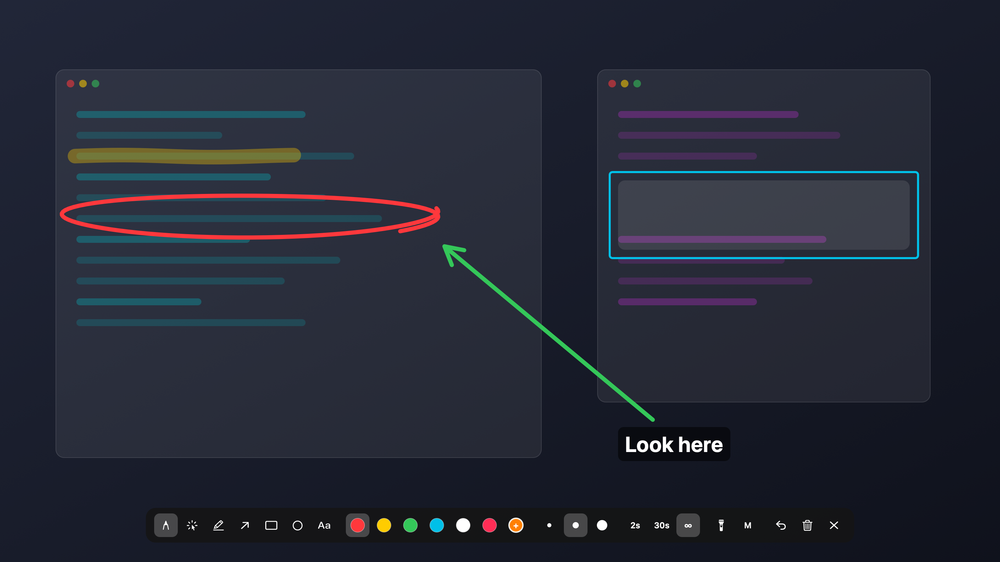
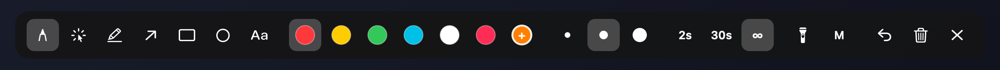
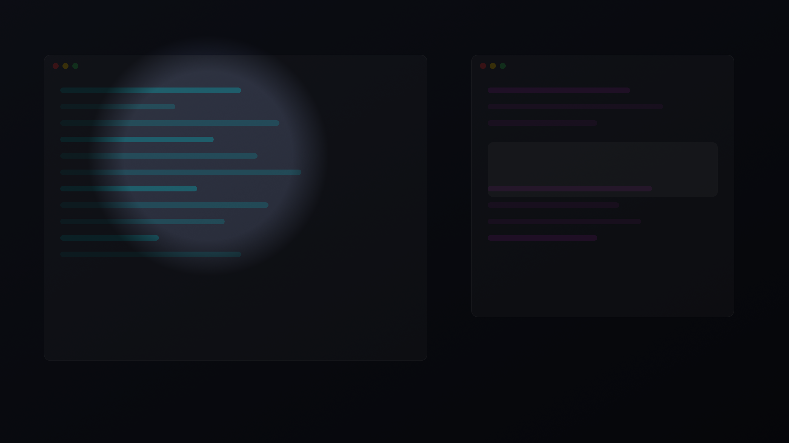
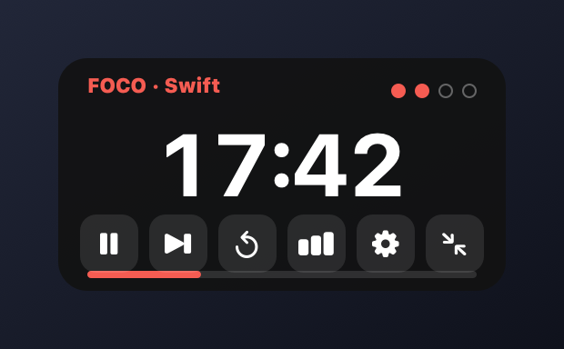
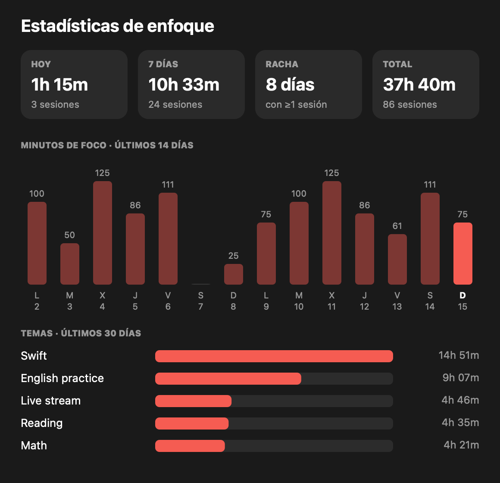

# ScreenInk

[](LICENSE)


**Dibuja sobre la pantalla, usa un pomodoro y apunta notas sin salir de lo que estás haciendo. App nativa de macOS en la barra de menús, pensada para directos y clases.**

[English](README.md)



## Por qué

Cuando hago directos o doy clase necesito señalar, rodear cosas y que las marcas desaparezcan solas, sin abrir una pizarra pesada. También quería un pomodoro siempre visible que no robe el foco, una forma de capturar una idea con un atajo y una señal clara de que el micrófono está silenciado. ScreenInk reúne todo eso en una app pequeña en Swift/AppKit, sin dependencias, que vive en la barra de menús y se maneja con atajos globales.

## Características

- **Capa de anotación** en todas las pantallas: lápiz, estela láser, resaltador, flecha, rectángulo, elipse y texto (con acentos e IME).
- **Trazos que se desvanecen**: elige 2 s, 30 s o fijo (no se borra). El desvanecido empieza al terminar el trazo.
- **Colores y tamaños**: 6 colores predefinidos, color libre, 3 grosores, deshacer y borrar todo.
- **Halo del cursor** con ondas al hacer clic, y **spotlight** que oscurece el resto de la pantalla (3 tamaños).
- **Pomodoro flotante**: siempre encima, no roba el foco, recuerda posición y estado, modo completo y compacto, tema por sesión y duraciones configurables.
- **Ventana de estadísticas**: hoy, últimos 7 días, racha, total, gráfico de 14 días y últimos 30 días por tema. Los focos interrumpidos (1 minuto o más) también se registran.
- **Nota rápida**: un atajo global abre un panel y guarda un archivo Markdown en la carpeta `Inbox` de un vault de Obsidian.
- **Indicador de micrófono** en la barra de menús (CoreAudio): verde = volumen de entrada mayor que cero, rojo = silenciado (volumen 0), blanco = sin dispositivo de entrada.
- **Arranque al iniciar sesión** mediante un LaunchAgent que instala `install.sh`.

## Música de foco

El pomodoro puede reproducir un archivo de audio mientras corre una fase de **foco**. Solo archivos locales (mp3, m4a, aac, wav, aiff); no se descarga ni se transmite nada. Usa audio que tengas derecho a usar.

- Se configura en **Ajustes del pomodoro…** (menú de la barra), sección "Música de foco": activarla, elegir el archivo, el volumen y qué pasa en el siguiente foco ("Continuar donde quedó" o "Empezar desde el inicio"). El elemento de menú **Música de foco** la activa y desactiva rápido.
- Suena solo con el pomodoro corriendo en fase de foco, se repite si el archivo es más corto que la sesión, entra con un fundido de 3 s y sale con otro de 3 s al pausar, saltar, reiniciar o terminar el foco. Los descansos van en silencio.
- Con la música activada, la tarjeta expandida muestra un botón de nota que la silencia o la reactiva hasta que se reinicie la app.
- Si el archivo no existe o no se puede leer, la música se desactiva y el diálogo de ajustes explica el motivo.

## Atajos de teclado

### Atajos globales (funcionan en cualquier app)

| Atajo | Acción |
|-------|--------|
| `Ctrl+Option+D` | Activar / salir del modo dibujo |
| `Ctrl+Option+L` | Puntero con estela láser (otra vez para salir) |
| `Ctrl+Option+H` | Halo del cursor y ondas al hacer clic |
| `Ctrl+Option+C` | Borrar todo al instante |
| `Ctrl+Option+F` | Spotlight del cursor |
| `Ctrl+Option+Q` | Nota rápida |
| `Ctrl+Option+P` | Mostrar / ocultar el pomodoro |
| `Ctrl+Option+S` | Iniciar / pausar el pomodoro |
| `Ctrl+Option+N` | Saltar a la siguiente fase del pomodoro |

### En modo dibujo

| Tecla | Acción |
|-------|--------|
| `P` `L` `H` `A` `R` `O` `T` | Lápiz, estela, resaltador, flecha, rectángulo, elipse, texto |
| `F` | Spotlight del cursor (la barra también tiene botón y botón de tamaño P/M/G) |
| `1`-`6` | Colores predefinidos |
| `K` | Color libre (abre el selector de color) |
| `[` `]` | Trazo más fino / más grueso |
| `S` | Cambia la duración del trazo: 2 s, 30 s, fijo |
| `Cmd+Z`, `Backspace` o `U` | Deshacer |
| `C` | Borrar todo |
| `Tab` | Ocultar / mostrar la barra |
| `Esc` | Salir del modo dibujo |
| Herramienta texto | Clic y escribe, `Enter` confirma, `Shift+Enter` nueva línea |

En el panel de nota rápida: `Enter` guarda, `Shift+Enter` inserta una línea nueva, `Esc` cancela.

## Instalación

**Requisitos:** macOS y el compilador de Swift (`xcode-select --install` instala las Command Line Tools). El código usa AppKit, Carbon y CoreAudio y no exige Apple Silicon, pero no se ha determinado la versión mínima de macOS (ver [Estado](#estado)).

```sh
git clone https://github.com/FreddyB200/screenink.git
cd screenink
./install.sh
```

`install.sh` compila con `swiftc -O *.swift`, copia el binario a `~/bin/ScreenInk`, escribe `~/Library/LaunchAgents/local.screenink.plist` y arranca la app. Vuelve a ejecutarlo tras cualquier cambio de código; sustituye la versión anterior.

Para probarlo sin instalar: `swiftc -O *.swift -o ScreenInk && ./ScreenInk`.

**Desinstalar** (deducido de lo que crea `install.sh`):

```sh
launchctl bootout "gui/$(id -u)/local.screenink"
rm -f ~/Library/LaunchAgents/local.screenink.plist ~/bin/ScreenInk
```

Opcionalmente borra también `~/Library/Application Support/ScreenInk/` (historial del pomodoro).

## Uso

1. Busca el icono del lápiz en la barra de menús. Su menú lista todas las acciones y sus atajos.
2. Pulsa `Ctrl+Option+D` para dibujar. Aparece una barra de herramientas abajo, en el centro de la pantalla donde está el cursor. `Tab` la oculta y `Esc` sale.
3. Fuera del modo dibujo la capa deja pasar los clics, así que no estorba.
4. Con `Ctrl+Option+S` empiezas un foco. Haz doble clic en el título del pomodoro para ponerle un tema; el botón del gráfico abre las estadísticas.
5. Con `Ctrl+Option+Q` capturas una nota.

El título en la barra de menús muestra `✏️`, más `●` mientras dibujas, más la luz del micrófono.

### Destino de la nota rápida

Las notas se escriben en `<vault>/Inbox/AAAA-MM-DD HHmmss.md` con un pequeño bloque de front matter (`origen`, `tipo`, `creado`). Nunca sobrescribe (añade `-2`, `-3`, ...) y solo escribe dentro de `Inbox`. La ruta del vault es una constante al inicio de `QuickNote.swift`:

```swift
let noteVaultPath = "~/SegundoCerebro"   // cámbiala por la carpeta de tu vault
```

`SegundoCerebro` es solo el nombre de carpeta del autor; edita la constante y vuelve a ejecutar `./install.sh`.

## Cómo funciona

- Una ventana transparente y sin bordes por pantalla, a nivel de salvapantallas. Ignora el ratón salvo en modo dibujo. Los trazos viven en memoria y se redibujan a 60 fps mientras haya algo visible.
- Los atajos globales usan `RegisterEventHotKey` de Carbon; las ondas de clic usan un monitor global del ratón.
- El pomodoro es un panel flotante que no se activa. Los focos terminados se añaden a un historial JSON; los ajustes y la posición usan `UserDefaults`.
- La luz del micrófono consulta cada 0,3 s el volumen del dispositivo de entrada por defecto vía CoreAudio (volumen 0 = silenciado, igual que el script hermano `toggle-mic`).

## Privacidad

- **Nada sale de tu equipo.** El código no contiene nada de red.
- Se guarda en local: preferencias en `UserDefaults` (colores, tamaños, ajustes y posición del pomodoro); el historial del pomodoro en `~/Library/Application Support/ScreenInk/history.json` (hora de fin, minutos, si se completó y el tema); las notas rápidas en la carpeta Inbox que configures.
- Los dibujos no se escriben nunca en disco y se pierden al salir.

## Imágenes de la documentación

Las imágenes de `docs/images` las genera la propia app, no son capturas de una pantalla real:

```sh
./ScreenInk --render-docs docs/images
```

En este modo ScreenInk dibuja sus propias vistas (capa de dibujo, barra, spotlight, pomodoro, estadísticas) fuera de pantalla en PNG a 2x, con su código de dibujo normal sobre un fondo sintético con anotaciones y datos de ejemplo inventados. No muestra ventanas, no registra atajos y nunca lee ni escribe tus ajustes ni tu historial real del pomodoro.






## Limitaciones

- La interfaz está en **español** (menús, textos del pomodoro y estadísticas, ayuda de la nota rápida). Aún no hay capa de localización.
- Las claves del front matter de las notas están en español (`origen`, `tipo`, `creado`).
- La luz del micrófono lee el *volumen* de entrada: no detecta un interruptor físico de silencio ni un silencio a nivel de app que no cambie el volumen.
- La duración "2s" son 2,5 s en el código, más 1 s de desvanecido.
- Herramienta personal: sin firmar ni notarizar, los atajos son fijos (están en `main.swift`) y no hay tests.

## Estado

Escrita y usada a diario por el autor en macOS. Esta documentación se ha hecho leyendo el código; está **sin probar** o sin verificar: la versión mínima de macOS; el comportamiento en Macs Intel; si el monitor global de clics (ondas del halo) provoca un aviso de permisos en una instalación limpia; más de dos monitores; y las apps a pantalla completa en todas las configuraciones. Se agradecen issues y pull requests.

Ideas futuras: localización (inglés/español), atajos configurables, app empaquetada con icono.

## Licencia

[MIT](LICENSE) © 2026 Freddy Bautista
