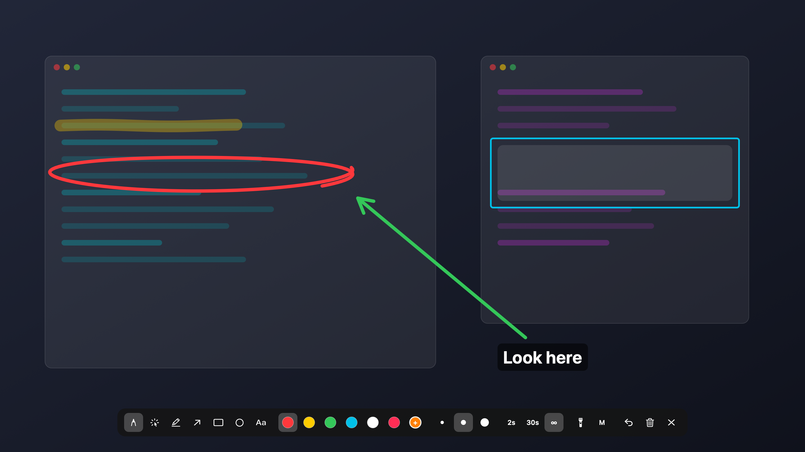
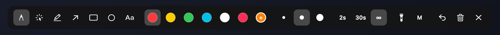
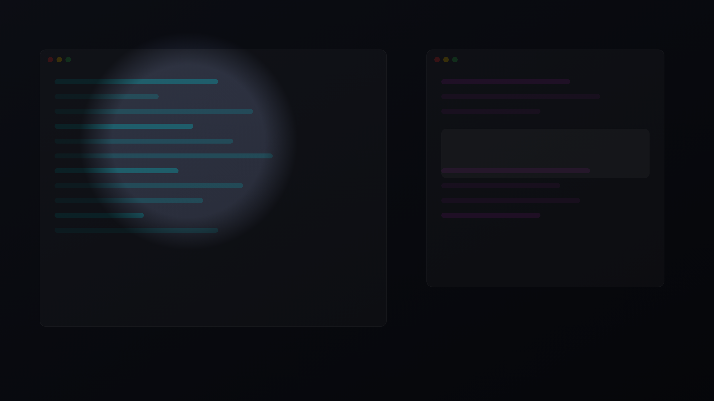
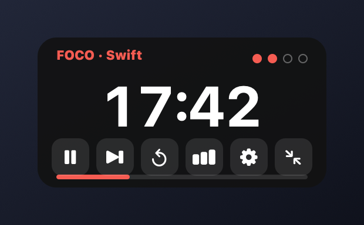
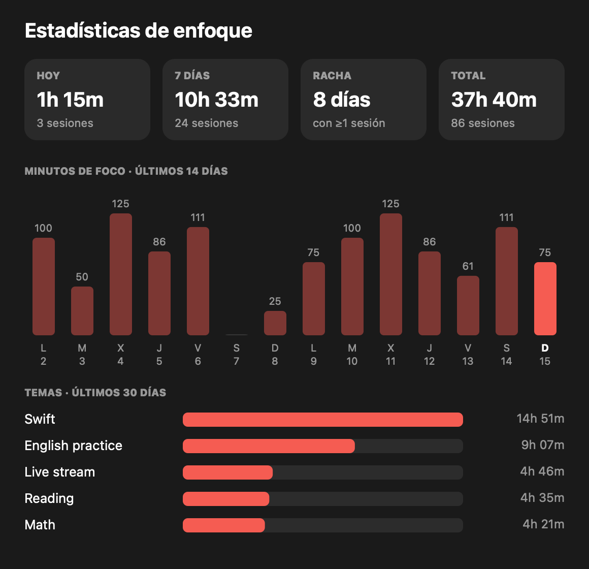

# ScreenInk

[](LICENSE)


**Draw on your screen, run a pomodoro and jot down notes without leaving what you are doing. A native macOS menu-bar app for live streams and teaching.**

[Español](README.es.md)



## Why

When I stream or teach, I need to point at things, circle them and let the marks disappear on their own, without opening a heavyweight whiteboard app. I also wanted a pomodoro timer that stays visible but never steals focus, a one-keystroke way to capture an idea, and a clear sign that my microphone is muted. ScreenInk puts all of that in one small, dependency-free Swift/AppKit app that lives in the menu bar and is driven by global hotkeys.

## Features

- **Annotation overlay** on every screen: pen, laser trail, highlighter, arrow, rectangle, ellipse and text (with accents and IME input).
- **Auto-fading strokes**: choose 2 s, 30 s or pinned (never fades). Fading starts after you finish a stroke.
- **Colors and sizes**: 6 preset colors, a free color picker, 3 pen sizes, undo and clear-all.
- **Cursor halo** with click ripples, and a **cursor spotlight** that dims the rest of the screen (3 sizes).
- **Floating pomodoro**: always on top, never takes focus, remembers its position and state, full and compact modes, a topic tag per session, configurable durations.
- **Statistics window**: today, last 7 days, streak, total, a 14-day chart and the last 30 days by topic. Interrupted focus sessions (1 minute or more) are logged too.
- **Quick note**: a global hotkey opens a small panel and saves a Markdown file into an Obsidian vault `Inbox` folder.
- **Microphone indicator** in the menu bar (CoreAudio): green = input volume above zero, red = muted (volume 0), white = no input device.
- **Launch at login** through a LaunchAgent installed by `install.sh`.

## Focus music

The pomodoro can play an audio file while a **focus** phase is running. Local files only (mp3, m4a, aac, wav, aiff); nothing is downloaded or streamed. Use audio you have the right to use.

- Configure it in the menu bar item **Ajustes del pomodoro…**, section "Música de foco": enable it, choose the file, set the volume and pick what happens at the next focus ("Continuar donde quedó" or "Empezar desde el inicio"). The menu item **Música de foco** toggles it quickly.
- It plays only while the pomodoro is running in a focus phase, loops if the file is shorter than the session, fades in over 3 s and fades out over 3 s on pause, skip, reset or end of focus. Breaks are silent.
- With music enabled, the expanded card shows a note button that mutes or unmutes the music until the app restarts.
- If the file is missing or unreadable, music is disabled and the settings dialog says why.

## Keyboard shortcuts

### Global hotkeys (work in any app)

| Shortcut | Action |
|----------|--------|
| `Ctrl+Option+D` | Toggle drawing mode |
| `Ctrl+Option+L` | Laser-trail pointer (press again to exit) |
| `Ctrl+Option+H` | Cursor halo and click ripples on/off |
| `Ctrl+Option+C` | Clear everything instantly |
| `Ctrl+Option+F` | Cursor spotlight on/off |
| `Ctrl+Option+Q` | Quick note |
| `Ctrl+Option+P` | Show / hide the pomodoro |
| `Ctrl+Option+S` | Start / pause the pomodoro |
| `Ctrl+Option+N` | Skip to the next pomodoro phase |

### In drawing mode

| Key | Action |
|-----|--------|
| `P` `L` `H` `A` `R` `O` `T` | Pen, laser trail, highlighter, arrow, rectangle, ellipse, text |
| `F` | Cursor spotlight (the toolbar also has a button and a P/M/G size button) |
| `1`-`6` | Preset colors |
| `K` | Free color (opens the color panel) |
| `[` `]` | Smaller / larger stroke |
| `S` | Cycle stroke duration: 2 s, 30 s, pinned |
| `Cmd+Z`, `Backspace` or `U` | Undo |
| `C` | Clear all |
| `Tab` | Hide / show the toolbar |
| `Esc` | Leave drawing mode |
| Text tool | Click and type, `Enter` confirms, `Shift+Enter` adds a new line |

In the quick-note panel: `Enter` saves, `Shift+Enter` inserts a new line, `Esc` cancels.

## Install

**Requirements:** macOS and the Swift compiler (`xcode-select --install` installs the Command Line Tools). The code is plain AppKit, Carbon and CoreAudio and does not require Apple Silicon, but the minimum supported macOS version has not been determined (see [Status](#status)).

```sh
git clone https://github.com/FreddyB200/screenink.git
cd screenink
./install.sh
```

`install.sh` compiles with `swiftc -O *.swift`, copies the binary to `~/bin/ScreenInk`, writes `~/Library/LaunchAgents/local.screenink.plist` and starts the app. Run it again after any code change; it replaces the previous version.

To run it once without installing: `swiftc -O *.swift -o ScreenInk && ./ScreenInk`.

**Uninstall** (derived from what `install.sh` creates):

```sh
launchctl bootout "gui/$(id -u)/local.screenink"
rm -f ~/Library/LaunchAgents/local.screenink.plist ~/bin/ScreenInk
```

Optionally also delete `~/Library/Application Support/ScreenInk/` (pomodoro history).

## Usage

1. Look for the pencil icon in the menu bar. Its menu lists every action and its hotkey.
2. Press `Ctrl+Option+D` to draw. A toolbar appears at the bottom center of the screen where the cursor is. Press `Tab` to hide it, `Esc` to leave.
3. Outside drawing mode the overlay is click-through, so it never gets in the way.
4. Use `Ctrl+Option+S` to start a focus session. Double-click the pomodoro title to set a topic tag; open the chart button for statistics.
5. Use `Ctrl+Option+Q` to capture a note.

The menu-bar title shows `✏️`, plus `●` while drawing, plus the microphone light.

### Quick note destination

Notes are written to `<vault>/Inbox/YYYY-MM-DD HHmmss.md` with a small front-matter block (`origen`, `tipo`, `creado`). It never overwrites an existing file (it appends `-2`, `-3`, ...) and only writes inside `Inbox`. The vault path is a constant at the top of `QuickNote.swift`:

```swift
let noteVaultPath = "~/SegundoCerebro"   // change this to your own vault folder
```

`SegundoCerebro` is just the author's folder name; edit the constant and re-run `./install.sh`.

## How it works

- One borderless, transparent window per screen sits at screen-saver level. It ignores mouse events unless drawing mode is on. Strokes are kept in memory and redrawn at 60 fps while something is visible.
- Global hotkeys use Carbon `RegisterEventHotKey`; click ripples use a global mouse monitor.
- The pomodoro is a non-activating floating panel. Finished focus sessions are appended to a JSON history file; settings and window position use `UserDefaults`.
- The microphone light polls the default input device's volume every 0.3 s via CoreAudio (volume 0 counts as muted, the same convention as the sibling `toggle-mic` script).

## Privacy

- **Nothing leaves your machine.** The source contains no networking code.
- Stored locally: preferences in `UserDefaults` (colors, sizes, pomodoro settings, window position); the pomodoro history in `~/Library/Application Support/ScreenInk/history.json` (end time, minutes, completed flag, topic tag); quick notes in the Inbox folder you configure.
- Drawings are never written to disk and are lost on quit.

## Documentation images

The images in `docs/images` are generated by the app itself, not captured from a real screen:

```sh
./ScreenInk --render-docs docs/images
```

In this mode ScreenInk draws its own views (drawing overlay, toolbar, spotlight, pomodoro, statistics) offscreen into 2x PNG files, using its normal drawing code on a synthetic background with sample annotations and invented sample data. It shows no windows, registers no hotkeys and never reads or writes your settings or your real pomodoro history.






## Limitations

- The interface is in **Spanish** (menus, pomodoro and statistics labels, quick-note hint). There is no localization layer yet.
- Quick-note front matter keys are in Spanish (`origen`, `tipo`, `creado`).
- The microphone light reads the input *volume*. It will not notice a hardware mute switch or an app-level mute that leaves the volume unchanged.
- The "2s" duration is 2.5 s in code, followed by a 1 s fade.
- Single-user, personal tool: not code-signed or notarized, no settings UI for hotkeys (they are fixed in `main.swift`), and no tests.

## Status

Written and used daily by the author on macOS. This documentation was produced by reading the code; the following are **untested** or unverified: the minimum macOS version; behavior on Intel Macs; whether the global click monitor (halo ripples) triggers a privacy permission prompt on a fresh install; behavior with more than two displays; and fullscreen apps in every configuration. Pull requests and issues are welcome.

Ideas for later: localization (English/Spanish), configurable hotkeys, an app bundle with an icon.

## License

[MIT](LICENSE) © 2026 Freddy Bautista
